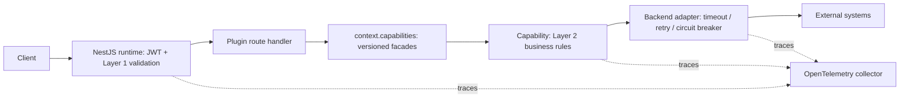

# API Platform Core

A TypeScript/NestJS platform for hosting versioned API plugins behind
platform-owned validation, authentication, observability and backend access.
The repository is an npm-workspace monorepo managed by Nx.

Start with [Contributing](./CONTRIBUTING.md) for development and plugin authoring,
or the [deployment guide](./deployment/README.md) for CI/CD and cluster setup.

## Status and prerequisites

- Node **22.15+ within the 22 LTS line**, or Node **26 LTS**.
- Nx 23.3.2, strict TypeScript, NestJS 11 and Zod 3.
- npm with access to the configured registry; a committed lockfile supports
  reproducible installs.
- Helm 3.17.3 and Docker for infrastructure and image verification.

This is a reference implementation, not a fully configured production service:

- JWT verification is implemented. **RBAC/scopes are not:** temporarily, every
  valid JWT for the configured issuer/audience can access all plugin routes.
- The default runtime injects no capabilities and enables no legacy SDK policy.
- Billing uses an injectable transport contract; a real backend integration
  has not been supplied.
- The reference plugin is registered but disabled. Environment catalogs are empty.
- Cloud resources, databases, secrets, DNS, approval gates and cluster credentials
  require external provisioning.

## Local development

From the repository root:

```powershell
npm ci
npx nx run-many -t build lint test --parallel=3
$env:OTEL_SDK_DISABLED = 'true'
npm start --workspace @api-platform/runtime
```

The default listener is `0.0.0.0:3000`. Check
`http://localhost:3000/health/ready`. Without JWT settings, plugin routes
return 401. See [runtime configuration](./apps/runtime/README.md) for
`APP_SETTINGS_PATH`, `JWT__*`, `PORT`, `HOST` and `PLUGIN_CATALOG_PATH`.
No local app-settings file or credentials are provided.

## Architecture



### Ownership and dependency boundaries

| Area | Responsibility |
|---|---|
| [Runtime](./apps/runtime/) | Startup orchestration, HTTP listener, route mounting, JWT and health endpoints |
| [Plugin API](./libs/plugin-api/) | Public manifest, route, lifecycle, context and capability contracts |
| [Plugins](./plugins/core-team-plugins/) | API contracts, request mapping and capability orchestration |
| [Capabilities](./capabilities/) | Semantic validation, business rules and adapter error translation |
| [Backend adapters](./backend-adapters/) | External communication and resilience |
| [Plugin loader](./platform/plugin-loader/) | Catalog validation, SDK compatibility, package version checks and imports |
| [Plugin registry](./platform/plugin-registry/) | Successfully registered plugin instances for this process |
| [Validation](./platform/validation/) | Zod request body/params/query and response validation |
| [Telemetry](./platform/telemetry/) | SDK initialization, W3C propagation, tracing and OTLP export |
| [Shared models](./shared-models/) | Shared runtime schemas and DTOs |

Plugins must use only `context.capabilities.*` for platform access. They do
not import adapters, implement database queries, call external systems directly,
or own authentication/authorization. Capabilities use adapters for external
access. Plugins declare host framework/SDK packages as peers, avoiding bundled
copies of Zod, NestJS or the OpenTelemetry API.

The authentication guard currently lives in the runtime. Dedicated auth and
authorization directories are placeholders, not completed security modules.

### Exact startup sequence

OpenTelemetry initializes before the engine imports NestJS. The engine then
executes these six phases:

1. **Load Plugin Catalog:** parse YAML and validate the catalog structure.
2. **Validate Plugin Compatibility:** validate enabled manifests and compare
   `supportedSdkRange` against the installed SDK version using semver.
3. **Load Plugins:** verify each installed package matches the catalog's exact
   version, dynamically import it and validate its default definition.
4. **Inject Capabilities:** build plugin-specific contexts and call `onInit`.
5. **Register Routes:** check paths/conflicts and create guarded Nest controllers.
6. **Start Runtime:** bind HTTP and make health endpoints available.

Malformed catalog structure fails startup. Per-plugin failures in phases 2-5
are logged and skipped so other plugins can load. Accepted legacy compatibility
requires an explicitly configured SDK version, a future expiry and a capability
factory that supplies the right shims. Expired/incompatible plugins are rejected.
Shutdown calls registered plugins' `onDestroy` hooks and flushes telemetry.

These are in-process error boundaries, **not an untrusted-code sandbox**.
Plugins must be trusted and reviewed; process termination, blocking code and
unbounded work cannot be isolated by `try/catch`.

### Request processing and validation

1. The shared JWT guard checks the bearer token against OIDC-discovered signing
   keys, allowing only RS256 and validating issuer, audience and lifetime.
2. The validation interceptor parses the body using `requestSchema`, plus
   optional `paramsSchema` and `querySchema`.
3. The handler receives the parsed body, capability-only context, and parsed
   `{ params, query }` metadata. Undeclared metadata sections are `undefined`.
4. Capabilities enforce semantic rules before performing the resend operation.
5. The interceptor validates the returned value using `responseSchema`.

Invalid input returns a standardized 400. Invalid output returns a sanitized
500 without exposing the output payload. Plugin execution failures are logged
and returned as sanitized 500 responses. Literal and named `:param` segments
are supported; overlapping routes are rejected and `/health` is reserved.

### Billing reference

The [billing plugin](./plugins/core-team-plugins/billing-reference-plugin/)
defines `POST /bills/resend`, accepts `{ "msisdn": "+123456789" }`, and
delegates to the billing v1 facade. The capability also supports a v2
object payload through explicit providers.

The [billing capability](./capabilities/billing-capability/) checks customer
existence/activity, bill existence and resend eligibility. Its domain error
contract is currently billing-local. The
[adapter](./backend-adapters/billing-adapter/) provides timeouts, bounded
read retries and a per-instance circuit breaker. Resends are **not retried**:
without backend idempotency, a timeout can follow a successful send.
The backend must recheck eligibility atomically when resending.

### Stateless execution and tracing

Runtime replicas keep no durable application sessions or local database state.
Plugin registries and adapter circuit breakers are process-local. Plugins and
capabilities must not use local memory as shared business state.

W3C trace context propagates through HTTP and Undici/`fetch`. Plugin context
adds `plugin.name` and `plugin.version`; wrapped capability calls add
`capability.name`, inherited by child adapter spans. Trace export uses OTLP
HTTP/JSON configured with `OTEL_*` variables. See the
[telemetry guide](./platform/telemetry/README.md).

Public health endpoints are `/health/startup`, `/health/ready` and
`/health/live`. They indicate successful runtime boot/liveness, not the
availability of every optional plugin or external backend.

## Repository layout

```text
apps/runtime/
libs/plugin-api/
capabilities/{customer,billing,payment,notification}-capability/
backend-adapters/{crm,billing,payment,notification}-adapter/
platform/{auth,authorization,validation,telemetry,plugin-loader,plugin-registry}/
shared-models/
plugins/core-team-plugins/billing-reference-plugin/
plugin-catalog/plugins.yaml
deployment/docker/Dockerfile
deployment/helm/platform-runtime/
environments/{dev,qa,staging,preprod,prod}/
```

Several directories are reserved for future implementation; empty directories
are not retained by Git.

## Build, release and deployment design

- Nx orders builds through workspace dependencies and runs affected checks in CI.
- Changesets independently versions publishable SDK/models/plugin packages;
  internal runtime, capabilities and adapters remain private.
- The runtime image contains compiled, installed plugin packages. Catalogs
  choose among those versions; startup does not fetch packages.
- GHCR stores the runtime image. npm package publishing uses a configurable
  registry; GHCR itself is not an npm registry.
- Deployment promotes one image digest through
  **DEV -> QA -> STAGING -> PREPROD -> PROD**, with no rebuild between stages.
- Helm supplies isolated namespace/config/catalog/secret references per
  environment, three probes, and an HPA with a maximum of 60 replicas.

External infrastructure must enforce separate databases, credentials and access
policies; namespace naming alone does not establish database isolation.
See the [deployment guide](./deployment/README.md) for setup and limitations.

## Tests

The Node test runner covers billing resilience/domain rules, runtime boot and
compatibility, JWT/OIDC, request/response validation, reference-plugin isolation,
and exported W3C trace continuity. Infrastructure tests check workflow invariants
and render Helm resources when Helm is available.

```powershell
npx nx run-many -t build lint test --parallel=3
node --test deployment/test/infrastructure.test.cjs
```

CI is configured to run application tests on Node 22 and 26. Real backend,
load and live-cluster validation are separate from the current mocked/local
integration tests.
